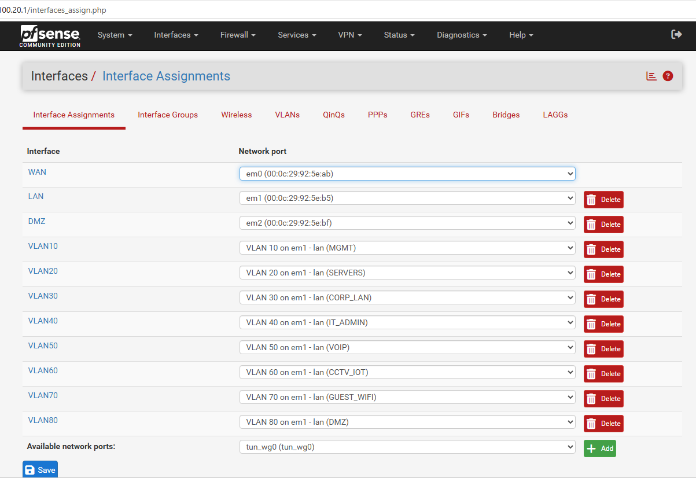
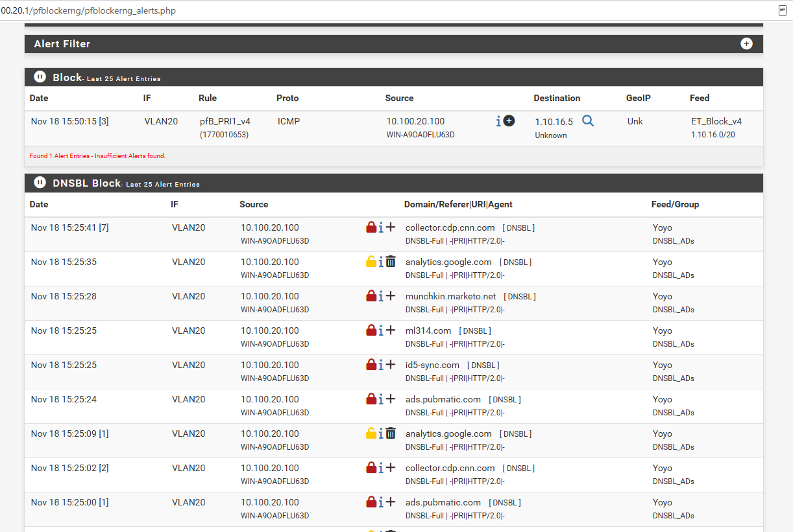
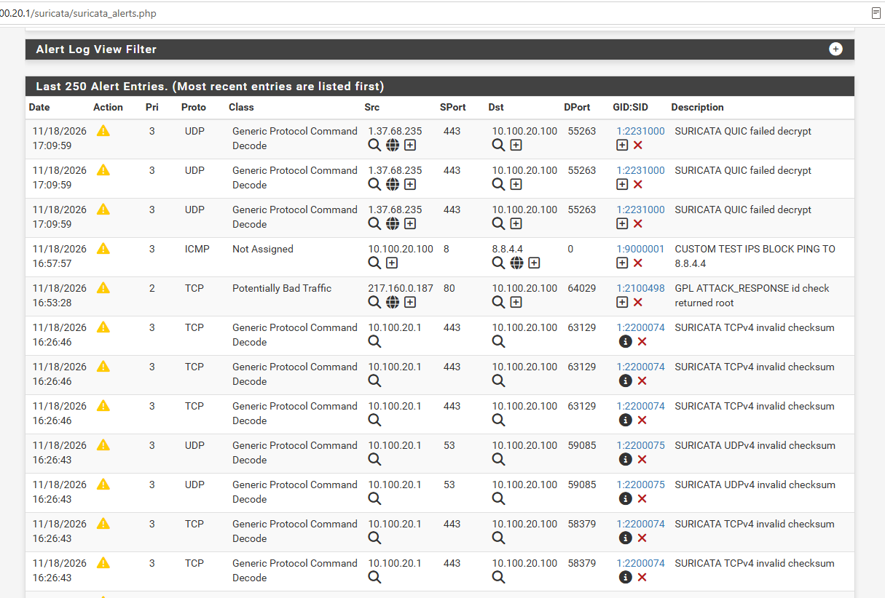

# 09 - pfSense 802.1Q VLAN Segmentation, pfBlockerNG & Suricata IDS/IPS Tuning

## Overview
Expanded the perimeter **pfSense CE (`pfSense-fw1`)** architecture by implementing 8-tier 802.1Q VLAN segmentation, DNS/IP-based threat filtering via **pfBlockerNG**, and Intrusion Detection/Prevention (**Suricata**) with false-positive suppression in **VMware Workstation 17 Pro**.

---

## 1. 802.1Q VLAN Segmentation & IP Addressing Plan
Configured 8 tagged VLAN sub-interfaces on the LAN trunk (`em1`) across the isolated `AD-Lab` VMware LAN segment, migrating the Active Directory Domain Controller (`WIN-A9OADFLU63D`) to **VLAN 20** using a `vmxnet3` virtual network adapter for native 802.1Q tagging.

| VLAN ID | Interface | Subnet / CIDR | Gateway IP | Enterprise Role |
| :--- | :--- | :--- | :--- | :--- |
| **VLAN 10** | `MGMT` | `10.100.10.0/24` | `10.100.10.1` | Firewall & Infrastructure Management |
| **VLAN 20** | `SERVERS` | `10.100.20.0/24` | `10.100.20.1` | Active Directory Domain Controller (`WIN-A9OADFLU63D`) |
| **VLAN 30** | `CORP_LAN` | `10.100.30.0/24` | `10.100.30.1` | Corporate Staff Workstations |
| **VLAN 40** | `IT_ADMIN` | `10.100.40.0/24` | `10.100.40.1` | IT Support & SysAdmin Workstations |
| **VLAN 50** | `VOIP` | `10.100.50.0/24` | `10.100.50.1` | IP Telephony |
| **VLAN 60** | `CCTV_IOT` | `10.100.60.0/24` | `10.100.60.1` | Physical Security & Isolated IoT |
| **VLAN 70** | `GUEST_WIFI` | `10.100.70.0/24` | `10.100.70.1` | Visitor Wireless Access |
| **VLAN 80** | `DMZ` | `10.100.80.0/24` | `10.100.80.1` | Public-Facing Services |

---

## 2. DNSBL & IP Threat Filtering (`pfBlockerNG`)
* **Backup Baseline:** Exported and validated full XML configuration recovery (`Diagnostics > Backup & Restore`) prior to package deployment.
* **Sinkhole VIP Configuration:** Created a `/32` IP Alias (`10.255.255.1`) on `Localhost` for the DNSBL webserver to avoid overlapping with `10.100.10.0/24`.
* **Threat Feeds & Whitelisting:** Enabled DNSBL (`Yoyo` tracker feed) and IPv4 threat blocklists (`ET_Block`, `Spamhaus_Drop`, `CINS_army`) across `LAN` and `VLAN20`. Analyzed real-time blocks under `Reports > Alerts` and implemented wildcard/exact whitelisting (e.g., `.google.com`, `.github.com`, `.atlassian.com`) to resolve false positives safely.

---

## 3. Suricata IDS/IPS Deployment & False-Positive Tuning
* **IDS-First Baseline:** Deployed Suricata on `VLAN20` initially in **IDS Mode** (`Block Offenders` unchecked) using *ETOpen Emerging Threats* and *Snort GPLv2 Community* rulesets to inspect traffic without risking production outages.
* **Virtualization & Offload Tuning:** Identified false-positive alerts caused by virtual NIC checksum offloading (`SID 1:2200074` TCPv4 invalid checksum and `SID 1:2200075` UDPv4 invalid checksum). Disabled hardware checksum, TSO, and LRO offloading under `System > Advanced > Networking` and suppressed both SIDs via the Suricata Suppress List.
* **IPS Validation & Remediation:** Enabled Legacy IPS Mode (`Block Offenders`) and validated active blocking against outbound test signatures (`SID 1:2100498` via `testmyids.com` and custom ICMP signature `SID 1:9000001`), followed by manual host unblocking under the `Blocks` tab and reverting to IDS Mode.

